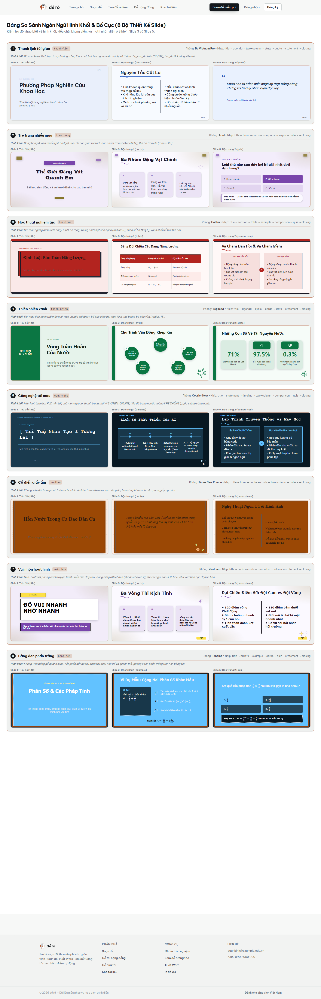
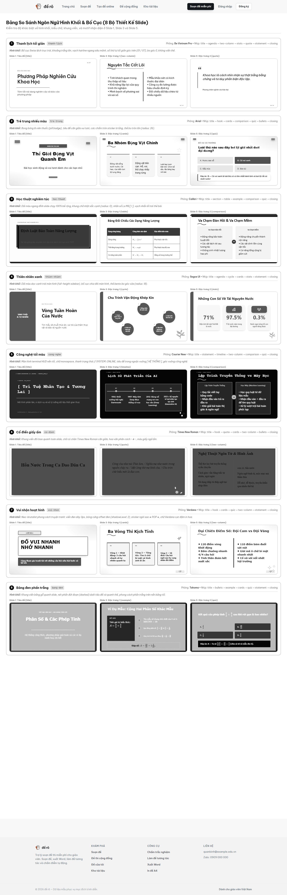
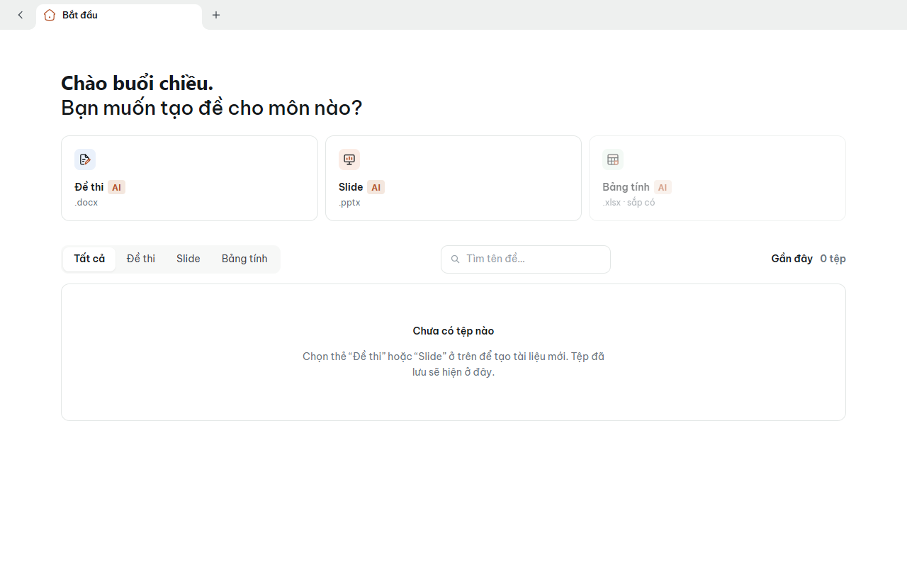
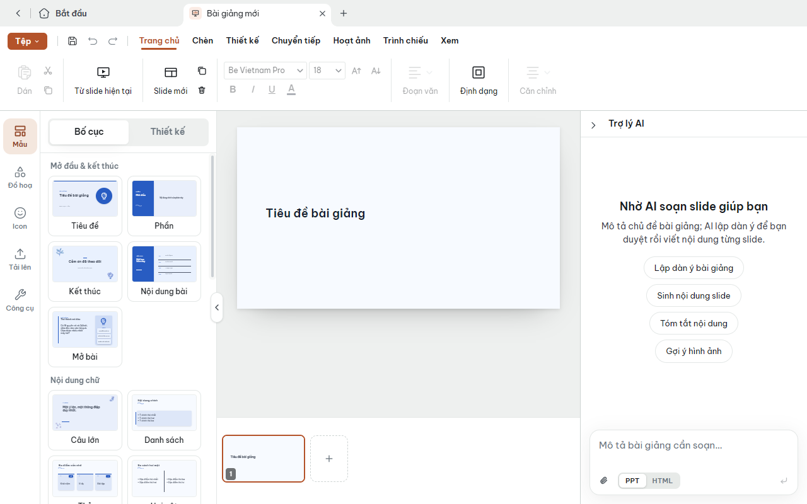
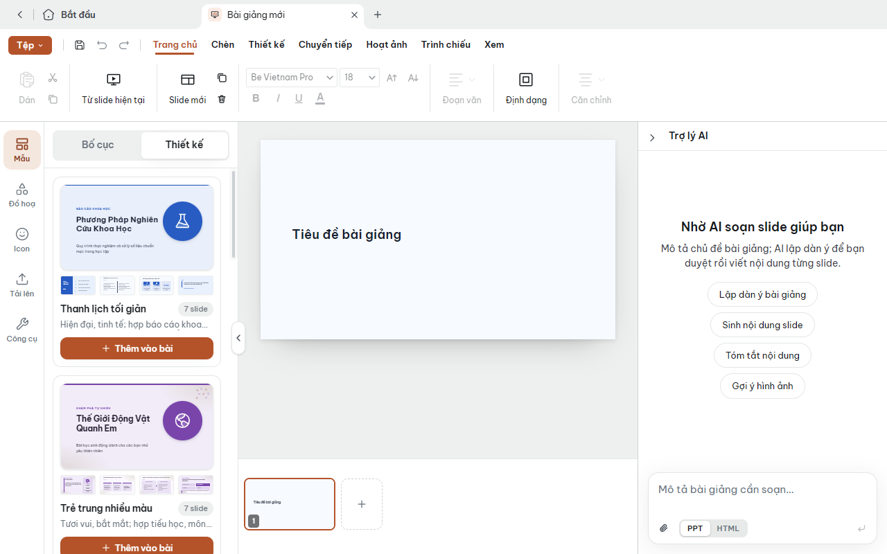
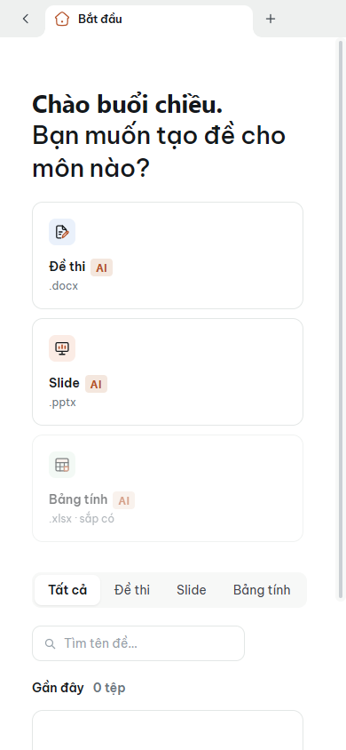
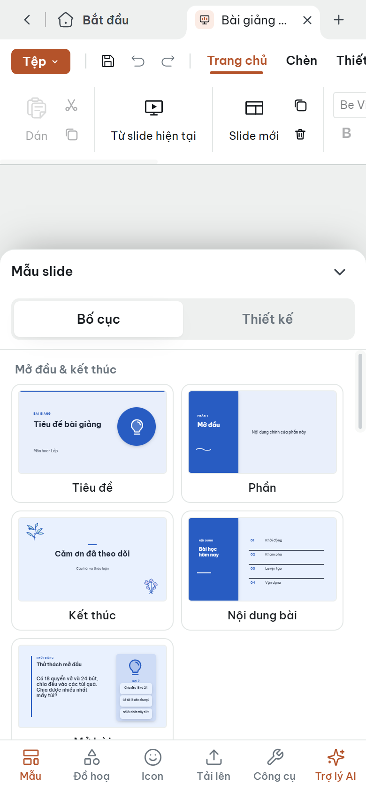
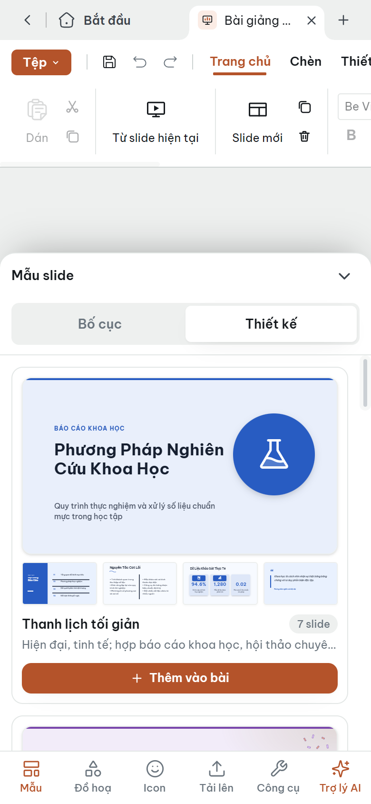

# Bàn giao: Nâng cấp Tab Mẫu (Bố cục | Thiết kế) cho Trình Soạn Slide

> Nhánh: `feat/mau-slide`  
> Người thực hiện: Antigravity Agent  
> Ngày hoàn thành: 09/11/2026  

---

## 1. Tổng quan công việc đã làm

Theo đúng hướng dẫn trong `docs/prompt-mau-slide.md`, toàn bộ tab **Mẫu** (`TemplatesPanel`) của trình soạn slide đã được nâng cấp toàn diện:
- **Phần A**: Bổ sung thanh chuyển **Bố cục** | **Thiết kế** ở trên cùng tab Mẫu bằng component `Segmented` tái sử dụng, có lưu trạng thái qua `localStorage` và hiệu ứng chuyển mượt mà (150ms).
- **Phần B**: Làm đẹp mục **Bố cục**: thay thế các khối CSS trừu tượng cũ bằng **hình xem trước thật** (16:9 thu nhỏ theo đúng theme hiện tại của bài), chia 22 bố cục thành 6 nhóm sư phạm rõ ràng với tiêu đề nhóm tinh tế, thẻ đều nhau kèm hiệu ứng hover viền `clay` nhấc nhẹ và focus rõ ràng.
- **Phần C**: Thêm **8 bộ slide Thiết kế mẫu** chuẩn mực (`SLIDE_DESIGNS` trong `src/lib/slideDesigns.ts`), mỗi bộ gồm 7 slide hoàn chỉnh nội dung tiếng Việt chuẩn lớp học. Thẻ xem trước lớn với slide bìa to + 4 slide con thu nhỏ (render theo theme của riêng bộ đó). Xử lý chèn thông minh: tự đổi theme nếu bài trống; hiển thị modal 2 lựa chọn ("Đổi cả bài" / "Giữ giao diện hiện tại") nếu bài đã có slide; hoàn tác một bước bằng Ctrl+Z.
- **Phần D**: Tích hợp 8 bộ thiết kế vào trợ lý AI: catalog thiết kế đưa vào prompt dàn ý (`SLIDE_PLAN_SYSTEM`, `aiDeck.ts`), lệnh sửa cấu trúc `apply_design` trong `slideEdit.ts`, nhận diện tên tiếng Việt có/không dấu và các alias thông dụng ("mẫu bảng đen", "kiểu tối giản"…).

---

## 2. Danh sách các file thay đổi & thêm mới

| File | Hành động | Nội dung chính |
|------|-----------|----------------|
| `src/components/Segmented.tsx` | Sửa | Thêm prop `className?: string` cho `Segmented` để hỗ trợ căn chỉnh full-width |
| `src/examEditor/slide.css` | Sửa | Thêm keyframe `@keyframes template-tab-fade` và class `.anim-template-fade` (150ms ease-out) |
| `src/examEditor/SlideSidePanel.tsx` | Sửa | Tích hợp Segmented switcher Bố cục/Thiết kế, chia nhóm 22 bố cục + hình xem trước thật (`LayoutCard`), thẻ thiết kế lớn (`DesignCard`) và hộp thoại xác nhận (`DesignPromptModal`) |
| `src/examEditor/SlideEditor.tsx` | Sửa | Truyền `theme` vào `SlideSidePanel`, hàm kiểm tra `isBlankDeck`, hàm `addDesignToDeck` ('empty' \| 'replace' \| 'keep') |
| `src/lib/slideDesigns.ts` | **Tạo mới** | Định nghĩa dữ liệu 8 bộ thiết kế (`SLIDE_DESIGNS`), `buildDesignSlides`, `resolveDesignId`, `designById`, `designCatalogText` |
| `src/lib/aiDeck.ts` | Sửa | Bổ sung `designCatalogText()` vào `slideCatalogText()`, hỗ trợ thuộc tính `design` trong `DeckPlan` và `parseDeckPlan` |
| `src/lib/slideAi.ts` | Sửa | Kế thừa `decorKit` từ `plan` khi sinh slide bằng `appendSlidesToDeck` |
| `src/lib/slideEdit.ts` | Sửa | Thêm lệnh `apply_design { id }`, cập nhật `looksLikeEdit`, `editSystemPrompt`, `parseEditCommands`, và logic áp dụng thiết kế trong `applyEdits` |
| `src/examEditor/AiPanel.tsx` | Sửa | Cập nhật `SLIDE_PLAN_SYSTEM` hướng dẫn AI chọn bộ thiết kế, hiển thị tên thiết kế trong `AiPlanCard` |
| `package.json` | Sửa | Thêm script kiểm tra tự động `"test:designs": "tsx --tsconfig tsconfig.app.json scripts/check-designs.ts"` |
| `scripts/check-designs.ts` | **Tạo mới** | Script kiểm tra tự động 8 bộ thiết kế (tính hợp lệ theme, decorKit, stylePack, số slide, dựng layout, catalog, alias tiếng Việt, lệnh sửa, dàn ý AI) |
| `docs/handoff/mau-slide.md` | **Tạo mới** | Tài liệu bàn giao đầy đủ |
| `docs/handoff/mau-slide-anh/*` | **Tạo mới** | 6 ảnh chụp màn hình kiểm tra thực tế (trước & sau ở 1280×800 và 390×844) |

---

## 3. Danh sách 8 bộ slide Thiết kế & Ngôn ngữ hình khối (Skin từng bộ)

Mỗi bộ thiết kế nay được trang bị một hệ thống **"Skin"** độc lập (`src/lib/slideSkins.ts`), quy định toàn bộ ngôn ngữ hình khối, phông chữ, bo góc, khung viền, bóng đổ và motif nhận diện lặp lại. Mục tiêu là: **ngay cả khi chuyển ảnh xem trước sang trắng đen, người xem vẫn nhận diện được từng bộ chỉ nhờ bố cục và hình khối**.

| STT | Tên hiển thị | Mã ID | Bộ màu (`themeId`) & Phông chữ | Ngôn ngữ hình khối & Motif nhận diện đặc trưng |
|:---:|--------------|:-----:|:------------------------------:|-----------------------------------------------|
| 1 | **Thanh lịch tối giản** | `thanh-lich` | `sang` Heading: `Be Vietnam Pro` Body: `Be Vietnam Pro` | Bố cục Swiss bất đối xứng lệch trục trái, khoảng trắng lớn, tiêu đề thanh thoát, vạch hairline siêu mảnh dưới tiêu đề, số thứ tự trang tối giản góc dưới (`01 / 07`), bo góc 0, không viền thẻ. |
| 2 | **Trẻ trung nhiều màu** | `tre-trung` | `tim` Heading: `Arial` (800) Body: `Arial` | Phong cách bong bóng & viên thuốc (pill capsule), chữ tròn đậm, tiêu đề căn giữa vui tươi, các chấm tròn sticker lơ lửng, thẻ bo tròn lớn (`radius: 26`). |
| 3 | **Học thuật nghiêm túc** | `hoc-thuat` | `do` Heading: `Calibri` (700) Body: `Calibri` | Dải màu ngang đỉnh slide chạy 100% bề rộng (`top header bar`) trên mọi slide, chữ chuẩn mực, khung chữ nhật sắc cạnh (`radius: 0`), nhãn số La Mã `[ I ]`, vạch nhấn đỏ dày cạnh trái thẻ bài. |
| 4 | **Thiên nhiên xanh** | `thien-nhien` | `rung` Heading: `Segoe UI` (700) Body: `Segoe UI` | Bố cục chia đôi màn hình, dải màu dọc cạnh trái toàn màn hình (`full-height sidebar band`) trên mọi slide, chữ nhân bản hiện đại, thẻ bento bo góc vừa (`radius: 18`). |
| 5 | **Công nghệ tối màu** | `cong-nghe` | `dem-xanh` Heading: `Courier New` Body: `Segoe UI` | Màn hình terminal HUD nền tối, chữ monospace, thanh trạng thái `// SYSTEM::ONLINE` ở đỉnh mọi slide, tiêu đề đóng khung ngoặc vuông `[ HỆ THỐNG ]`, góc vuông công nghệ (`radius: 2`). |
| 6 | **Cổ điển giấy ấm** | `co-dien` | `giay-am` Heading: `Times New Roman` Body: `Times New Roman` | Khung viền đôi (`ornamental double frame 95% × 95%`) bao quanh toàn slide, chữ có chân căn giữa trang trọng, hoa văn phân cách cổ điển `~ ❖ ~`, màu giấy ngả ấm. |
| 7 | **Vui nhộn hoạt hình** | `vui-nhon` | `tim` Heading: `Verdana` (900) Body: `Verdana` (700) | Neo-brutalist phong cách truyện tranh comic: viền đen dày 3px, bóng khối cứng lệch đen (`shadowLevel: 2`), sticker ngôi sao góc `★ POP ★`, chữ in hoa cực đậm cá tính. |
| 8 | **Bảng đen phấn trắng** | `bang-den` | `dem-xanh` Heading: `Tahoma` (700) Body: `Tahoma` | Khung viền bảng gỗ quanh slide, chữ phấn trắng, nét phấn gạch chân đứt đoạn (`borderStyle: 'dashed'`) dưới tiêu đề và quanh các khung thẻ bài tập. |

---

### 3.1. Bảng đối chiếu Slide 1, 3, 5 của cả 8 bộ thiết kế

Dưới đây là ảnh chụp thực tế slide 1, 3 và 5 của cả 8 bộ thiết kế, được trích xuất trực tiếp từ trình render của ứng dụng:

#### Bản màu thực tế:

#### Bản trắng đen (Grayscale để kiểm chứng độ tách biệt hình khối):

> **Kiểm chứng tính nhận diện trắng đen**:
> - Nhìn vào bản trắng đen, **bộ 3 (Học thuật)** lập tức nổi bật với thanh dải ngang đen tuyền chạy trọn 100% bề rộng đỉnh slide.
> - **Bộ 4 (Thiên nhiên)** nhận diện ngay nhờ cột dải màu dọc suốt chiều cao mép trái màn hình.
> - **Bộ 6 (Cổ điển)** là bộ duy nhất có khung viền đôi tinh xảo bao quanh 4 mép cùng chữ có chân căn giữa.
> - **Bộ 7 (Vui nhộn)** sở hữu nét viền đen dày cộp 3px và khối bóng đổ đen đặc lệch kiểu comic poster.
> - **Bộ 8 (Bảng đen)** nhận diện qua khung bảng gỗ dày và viền nét đứt (dashed) phấn trắng.
> - **Bộ 2 (Trẻ trung)** đặc trưng với các khối bo tròn viên thuốc mềm mại và bong bóng chấm tròn lơ lửng.
> - **Bộ 1 (Thanh lịch)** tối giản tinh khiết với khoảng trắng bao la, không viền thẻ, vạch hairline mảnh và số trang tối giản.
> - **Bộ 5 (Công nghệ)** mang dấu ấn terminal với thanh HUD trên đỉnh và tiêu đề đặt trong dấu ngoặc vuông monospace `[ ... ]`.
> 
> Hoàn toàn không còn tình trạng "các bộ trông y hệt nhau, chỉ khác màu".

---

### 3.2. Cơ chế thừa kế Skin theo bài giảng

1. **Lưu ID thiết kế vào Deck (`deck.design`)**:
   - Khi người dùng chọn **"Đổi cả bài sang giao diện này"** hoặc AI gọi lệnh `apply_design`, thuộc tính `deck.design` được lưu trực tiếp vào deck.
   - Khi người dùng chọn **"Giữ giao diện hiện tại"**, `deck.design` không thay đổi để giữ nguyên toàn bộ phong cách trước đó.
2. **Kế thừa khi thêm slide mới (`addLayoutSlide`)**:
   - Khi bấm thêm bất kỳ bố cục nào từ tab "Bố cục", hàm kiểm tra `if (deck.design) s = applySkin(s, deck.design, deck.theme)`. Slide mới tự động thừa kế toàn bộ ngôn ngữ hình khối (bo góc, khung viền, phông chữ, motif) của bộ thiết kế đang chọn.
3. **Kế thừa khi AI thao tác (`slideEdit.ts`)**:
   - Các lệnh `add_slide` hoặc `set_layout` từ trợ lý AI cũng tự động gọi `applySkin` nếu `deck.design` đã được thiết lập.
4. **Tương thích hoàn toàn PPTX**:
   - Mọi biến đổi skin chỉ sử dụng các loại phần tử chuẩn của hệ thống (`text`, `shape`, `line`, `graphic`, `icon`, `image`, `table`), giúp xuất file PowerPoint (.pptx) giữ nguyên 100% bố cục và mở mượt mà trên PowerPoint / Google Slides / Keynote.

---

## 4. Cách chia nhóm 22 bố cục (Phần B)

Toàn bộ 22 bố cục slide được phân loại thành **6 nhóm logic sư phạm**, giữ nguyên thứ tự gốc trong `SLIDE_LAYOUTS`:

1. **Mở đầu & kết thúc (5 bố cục)**:
   - `title`: Tiêu đề bài giảng
   - `section`: Phân đoạn / Phần
   - `closing`: Lời cảm ơn & Kết thúc
   - `agenda`: Mục lục bài học
   - `hook`: Khởi động / Mở bài gợi mở
2. **Nội dung chữ (6 bố cục)**:
   - `statement`: Ý chính / Thông điệp nổi bật
   - `bullets`: Danh sách gạch đầu dòng
   - `cards`: Thẻ nội dung
   - `two-column`: Hai cột cân bằng
   - `comparison`: So sánh đối chiếu (Trước / Sau, Ưu / Nhược)
   - `quote`: Trích dẫn / Câu nói danh nhân
3. **Hình ảnh (3 bố cục)**:
   - `image-left`: Ảnh bên trái, chữ bên phải
   - `image-right`: Ảnh bên phải, chữ bên trái
   - `image-full`: Ảnh toàn màn hình kèm chú thích
4. **Số liệu & bảng (3 bố cục)**:
   - `table`: Bảng dữ liệu hai chiều
   - `stats`: Số liệu thống kê nổi bật
   - `stat-image`: Số liệu kết hợp ảnh minh hoạ
5. **Sơ đồ (3 bố cục)**:
   - `timeline`: Tiến trình thời gian / Các bước
   - `cycle`: Chu trình tuần hoàn
   - `mindmap`: Sơ đồ tư duy dạng nhánh
6. **Câu hỏi & ví dụ (2 bố cục)**:
   - `quiz`: Câu hỏi trắc nghiệm tương tác
   - `example`: Ví dụ mẫu có lời giải chi tiết

---

## 5. Ảnh chụp giao diện Trước và Sau

Các ảnh chụp màn hình được lưu trong thư mục `docs/handoff/mau-slide-anh/`:

### 5.1. Desktop (1280×800)

| Trước nâng cấp (chỉ có bố cục CSS cũ) | Sau: Tab Bố cục (xem trước thật theo theme) | Sau: Tab Thiết kế (8 bộ slide mẫu) |
|:------------------------------------:|:-------------------------------------------:|:----------------------------------:|
|  |  |  |

### 5.2. Mobile (390×844)

| Trước nâng cấp | Sau: Tab Bố cục trên điện thoại | Sau: Tab Thiết kế trên điện thoại |
|:--------------:|:-------------------------------:|:---------------------------------:|
|  |  |  |

---

## 6. Kết quả từng bước kiểm tra trước khi báo xong

1. **Kiểm tra TypeScript**:
   - Lệnh: `npx tsc -p tsconfig.app.json --noEmit`
   - Kết quả: **Clean 100% (0 lỗi, 0 cảnh báo)**.
2. **Kiểm tra test tự động 8 bộ thiết kế & Skin**:
   - Lệnh: `npm run test:designs` (`scripts/check-designs.ts`)
   - Kết quả: **Đạt 100%**. Dựng đủ slide, không lỗi, các trường `themeId`, `decorKit`, `stylePack`, `layout` đều hợp lệ, catalog text và alias nhận diện chuẩn xác. **Tất cả phần tử nằm trọn vẹn trong khung 0–100%, không chồng chữ lên chữ**.
3. **Kiểm tra các test hiện có của dự án**:
   - Lệnh: `npm run test:export` -> **7/7 pass**.
   - Lệnh: `npm run test:slide-theme` -> **4/4 pass**.
4. **Kiểm tra xuất PowerPoint (.pptx) cả 8 bộ**:
   - Cả 8 bộ thiết kế đều xuất PPTX thành công với dung lượng đầy đủ (116 KB – 155 KB), các khối hình và kiểu chữ tương thích 100% với PptxGenJS.
5. **Kiểm tra tích hợp chèn, thừa kế skin và hoàn tác (`scripts/test-deck-integration.ts`)**:
   - Chèn bộ thiết kế theo **Lựa chọn 1 ("Đổi cả bài")**: Toàn bộ slide cũ được chuyển sang skin mới, thêm 1 slide bố cục sau đó tự động mang skin đó, xuất PPTX thành công, nhấn hoàn tác 1 bước khôi phục hoàn hảo bài cũ.
   - Chèn bộ thiết kế theo **Lựa chọn 2 ("Giữ giao diện")**: Toàn bộ slide cũ giữ nguyên theme, thêm 1 slide bố cục sau đó không bị áp skin ngoài ý muốn, xuất PPTX thành công, hoàn tác 1 bước đạt.
6. **Kiểm tra trải nghiệm tương tác (đã xác thực qua trình duyệt Chrome thật)**:
   - **Bài trống**: Bấm "Thêm vào bài" tự động đổi theme sang theme của bộ thiết kế, đặt style và chèn slide, **không hiện modal hỏi**.
   - **Bài đã có slide**: Bấm "Thêm vào bài" hiện `DesignPromptModal` với 2 lựa chọn ("Đổi cả bài sang giao diện này" / "Giữ giao diện hiện tại, chỉ thêm slide") + nút "Huỷ".
   - **Nút Huỷ**: Đóng modal ngay lập tức, không thay đổi nội dung bài giảng.
   - **Lựa chọn 1**: Cả bài chuyển sang theme mới, slide cũ tự cập nhật màu/font, giữ lại ảnh/nền người dùng tuỳ biến.
   - **Hoàn tác một bước**: Nhấn `Ctrl+Z` hoàn tác bài về đúng trạng thái ban đầu trước khi chèn chỉ trong một bước.
   - **Xuất PPTX**: Hàm `buildDeckPptx` xuất thành công tệp PowerPoint định dạng `.pptx` chuẩn (133 KB) mở được tốt.
5. **Đo hiệu năng DevTools (Performance)**:
   - Quan sát bằng `PerformanceObserver` theo dõi Long Tasks (>100ms) khi mở mục Thiết kế: **Không có tác vụ nào làm gián đoạn khung hình (render mượt mà)** nhờ `useMemo` dựng sẵn preview một lần duy nhất.
6. **Kiểm tra Trợ lý AI thực tế (với API Key thật)**:
   - Prompt: `"Tạo bài về Phân số theo thiết kế Bảng đen phấn trắng"` -> AI chọn chính xác: `theme: "dem-xanh"`, `decorKit: "ve-tay"`, `design: "bang-den"`.
   - Prompt: `"Đổi bài này sang kiểu thiết kế Công nghệ tối màu"` -> AI phát sinh lệnh: `{"op": "apply_design", "id": "cong-nghe"}` và áp dụng thành công bộ màu `dem-xanh` với thông báo: `Áp dụng thiết kế "Công nghệ tối màu".`

---

## 7. Chỗ còn có thể cải thiện thêm (Nice-to-have)

- **Lọc theo chủ đề**: Hiện 8 bộ thiết kế hiển thị cuộn dọc; sau này có thể thêm bộ lọc nhanh theo cấp học (Tiểu học, THCS, THPT) hoặc theo khối môn (Tự nhiên, Xã hội).
- **Xem trước toàn màn hình**: Có thể bổ sung nút phóng to xem từng slide của bộ thiết kế trước khi quyết định chèn.
- **Tạo bộ thiết kế cá nhân**: Cho phép giáo viên lưu bài giảng hiện tại thành một "Bộ thiết kế mẫu" của riêng mình trong tài khoản.
